<picture>
  <source media="(prefers-color-scheme: dark)" srcset="assets/banner-dark.svg">
  
</picture>

I build things that measure the physical world: the phase of an echo, the shape of a press-up, handwriting on an invoice. Then I try to catch them being wrong, with an evaluation table, a replay harness, or a human review queue. London.

<picture>
  <source media="(prefers-color-scheme: dark)" srcset="assets/divider-dark.svg">
  
</picture>

## Featured

### [Sonar Reps](https://github.com/adityamitter15/sonar-reps)

<a href="https://github.com/adityamitter15/sonar-reps">
<picture>
  <source media="(prefers-color-scheme: dark)" srcset="assets/sonar-dark.svg">
  
</picture>
</a>

Schematic, not a recording.

Counts push-ups on an iPhone from the echo of near-ultrasonic tones, with no camera. Built with a team of four in one day at the QMUL AI x CS Hackathon: **2nd place out of about 25 teams.** Swift and SwiftUI on the phone, Python signal processing behind it.

From its README, exactly: "39 of 40 full push-ups counted, 15 of 15 half reps refused, phone shaking blocked."

It also lists what gets through: "A hand moved up and down over the phone counts as a rep, and so does a kneeling push-up."

A real recorded set

 

### [Handwritten Invoice OCR](https://github.com/adityamitter15/invoice-ocr-prototype)

<a href="https://github.com/adityamitter15/invoice-ocr-prototype">
<picture>
  <source media="(prefers-color-scheme: dark)" srcset="assets/invoice-dark.svg">
  
</picture>
</a>

Schematic, not a recording.

Reads handwritten supplier invoices with TrOCR, EasyOCR and Tesseract, then puts each one in a review queue where a manager corrects errors and approves it. Corrections feed a fine-tuning loop. FastAPI and React.

From its README, exactly: "Mean character error rate on 2,169 evaluation crops: 4.34%. Exact-match on 97.7% of crops."

<picture>
  <source media="(prefers-color-scheme: dark)" srcset="assets/divider-dark.svg">
  
</picture>

## Also

### [PressPass](https://github.com/adityamitter15/presspass)

<a href="https://github.com/adityamitter15/presspass">
<picture>
  <source media="(prefers-color-scheme: dark)" srcset="assets/presspass-dark.svg">
  
</picture>
</a>

Schematic, not a recording.

An iOS app that verifies press-ups on-device with the front camera, built around a harness that replays recorded sessions through the code that runs on the phone. Its README says there are no accuracy numbers yet, so I quote none.

### More

- **[DKK London](https://github.com/adityamitter15/dkk-site)**: website for Daigaku Karate Kai London, live at [goju-karate.co.uk](https://www.goju-karate.co.uk).
- **[HELIOS](https://github.com/adityamitter15/helios-portfolio)**: my one-person web studio, live at [builtbyhelios.vercel.app](https://builtbyhelios.vercel.app).

**Stack:** Python, NumPy, SciPy, PyTorch, FastAPI, Swift, SwiftUI, TypeScript, JavaScript, React, Next.js, Tailwind CSS, Firebase Hosting.

Thanks for stopping by.

